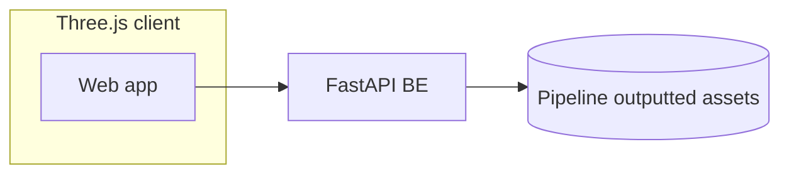
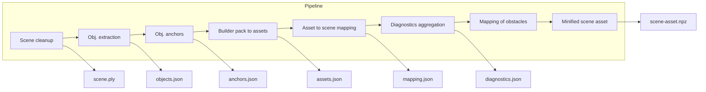

<!-- font_size: 2 -->
<!-- incremental_lists: true -->
## Valmet 3DGS Boiler Room solution overview

This solution includes three parts:

1. Data pipeline for generating assets
2. An assets server
3. A demo client application

<!-- end_slide -->
<!-- font_size: 2 -->
<!-- incremental_lists: true -->
### The data pipeline

The data pipeline processes the 3d gaussian splatting data and the excel builder pack spreadsheet to
produce derived data like cleaned scene data, object anchors, object-to-asset mapping, etc.

The data pipeline runs locally and uses standard tools to perform the cleanup and derivations

<!-- end_slide -->
<!-- font_size: 2 -->
<!-- incremental_lists: true -->
### The pipeline consists of the following steps

1. Scene preparation
  - Determines directions, units, axes
  - artifact: scene.npz, used for later steps (Scene)
2. Object extraction
  - Voxelize the scene in order to create bounding boxes for objects
  - artifacts: objects.json
3. Incorporation of object anchors
  - Use optionally manually reviewed object anchors to map out objects more accurately
4. Compile assets from builder pack excel file
  - Read the workbook with the standard library into pack.json: 30 synthetic asset records
<!-- end_slide -->
<!-- font_size: 2 -->
<!-- incremental_lists: true -->
### The pipeline consists of the following steps

5. Map builder pack assets to segmented objects
  - Make a best-effort mapping between builder pack assets and objects detected during step 2/3
6. Diagnose
  - A deterministic join for the faulty target P-005: state, telemetry, alarms, data-quality cases and documents, with every claim citing an evidence id
7. Route computing: a collision-free path to the target, planned with A*
  - Uses scene geometry, mapped assets, and other objects
  - An occupancy grid at 0.10 m with four obstacle layers: object boxes, near-vertical surfaces, overhead structure and unobserved floor, inflated for the robot's body
8. Stripped Scene asset creation
  - Strip the input .ply data to make a smaller file that can be provided to the three.js client app
<!-- end_slide -->
<!-- font_size: 2 -->

### FastAPI Server
<!-- incremental_lists: true -->

The server consumes the outputs of the data pipeline:

- the viewer scene PLY, objects.json, assets.json, anchors.json, mapped.json, route.json, diagnosis.json

These files hold the data needed to populate the three.js demo scene

- Data is served from asset files as either application/json or octet-stream
- The server can run locally or be hosted somewhere else

<!-- end_slide -->
<!-- font_size: 2 -->
<!-- incremental_lists: true -->

### Three.js demo client

<!-- end_slide -->
<!-- font_size: 2 -->
<!-- incremental_lists: true -->

The demo consists of two parts:

1. The main scene

- The scene is fetched as a minified .ply file from the FastAPI backend, it is then rendered.
- Based on the selected layer, the relevant assets are pulled from the backend and layered ontop of the scene.

2. UI

The UI is made with React and it hosts the controls of the demo and the aggregated diagnostics data for each identified object from the builders pack

<!-- end_slide -->
